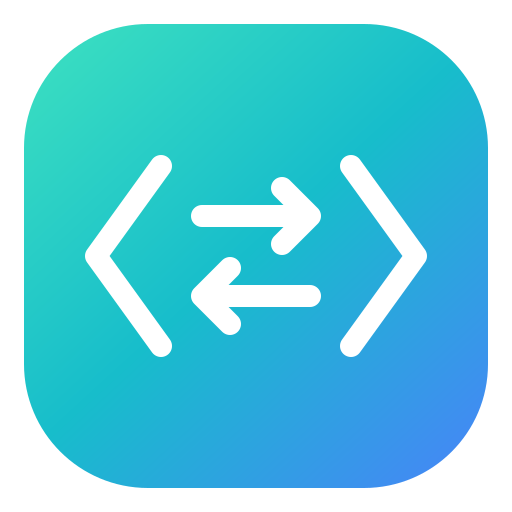

<p align="center">
  
</p>

<h1 align="center">Webhola</h1>

<p align="center">A desktop debugging toolkit for website development.</p>

<p align="center">
  <a href="README.zh-CN.md">简体中文</a> · English
</p>

Webhola brings HTTP request inspection, request replay and local Java service diagnostics into one window, making it easier to track down problems in requests, responses and internal service calls.

It is currently developed and verified primarily on Windows x64.

## Features

- **HTTP and MySQL capture**: listen on a selected adapter and port, then inspect HTTP requests and responses or MySQL commands with their SQL text and result summary, with search and copy.
- **Request replay**: resend captured requests and inspect the new response or error while keeping the original record.
- **Service discovery**: scan local HTTP / JVM services, pick a port and match the capture adapter.
- **Body inspection**: view raw content, format JSON, preview images, and read bodies in a separate full-screen window.
- **Java service diagnostics**: connect to a local JVM and inspect Spring routes, memory, method arguments, return values, exceptions, call trees and decompiled source.
- **Interface settings**: Chinese / English, plus system, light and dark themes.

## Installation and prerequisites

Install the Windows x64 build with the installer; see the [Windows installer guide](installer/README.md) for details. Two optional dependency groups:

| Feature | Requirements |
| --- | --- |
| Desktop HTTP capture | Npcap on Windows; system capture interfaces on Linux/macOS |
| JVM diagnostics | A JDK with attach support compatible with the target JVM, and Arthas |

JVM dependencies are unnecessary if you only capture HTTP traffic. Npcap installation and actions that require administrator rights still need user confirmation. To build from source, see the [development guide](docs/development.md).

## Getting started

### Inspect HTTP requests

1. Start Webhola. It enumerates available capture adapters automatically; on Windows, Npcap must already be installed.
2. Click **Scan HTTP services** and choose a service, or enter the port manually, for example `8080` for HTTP or `3306` for MySQL.
3. Choose the adapter that carries the traffic: loopback for localhost requests, WLAN or Ethernet for LAN requests.
4. Click **Start capture**, then send requests from a browser or client.
5. Select a record on the left to inspect the request and response on the right. You can copy content, format JSON, open full screen, or click **Resend**.
6. Click **Stop capture** to keep the current records. Clear does not stop capture; starting again clears the previous session.

### Diagnose Java services

1. Configure the JDK and Arthas in Settings.
2. Scan and select a service recognized as JVM, then open **JVM routes and tracing…**.
3. Connect and scan routes, pick a target method, start watch or trace, then trigger business requests.
4. Inspect call records, arguments, return values or the call tree, and drill into methods or decompiled source when needed.
5. Stop observing and close the diagnostics tab when finished.

Connection requirements, class loaders and limitations are covered in [JVM diagnostics](docs/jvm-diagnostics.md).

### Adjust the interface

Switch between Chinese and English via **View → Language**, and choose a theme via **View → Theme**; preferences are saved. **Help → About Webhola** shows the current version.

### Demo and offline capture files

```powershell
.\Webhola.exe --demo
.\Webhola.exe --read C:\captures\sample.pcapng
```

Demo mode does not listen on the network. Offline reading needs no external capture program: enter a port and start reading.

## Current limitations

- Capture supports plaintext HTTP/1.x and MySQL without TLS or compression. HTTPS is not decrypted, and HTTP/2, HTTP/3 and post-upgrade WebSocket messages are not parsed.
- MySQL on a non-default port is detected by a short local probe when capture starts; MySQL records cannot be resent.
- Only traffic on the selected adapter is visible. Connections that existed before capture are taken over from the next complete HTTP message; packet loss may leave records incomplete.
- Each body previews at most 64 KiB, and up to 1000 records are kept in memory and cleared on exit.
- JVM diagnostics target local JVMs; route scanning supports Spring HandlerMethods and requires permissions for the target process.
- Linux/macOS have not been fully verified on real devices.

See [HTTP capture](docs/http-capture.md) for more behavior and limits. Architecture, development guide, roadmap and validation records are collected in the [documentation index](docs/README.md).
