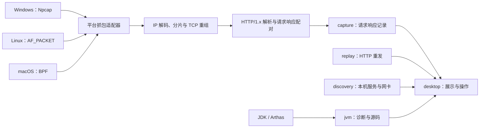
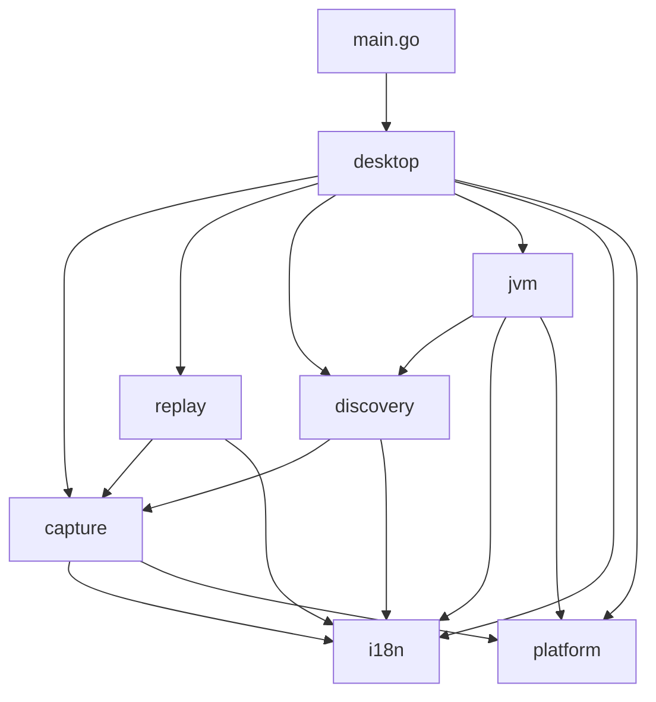

# 架构说明

## 当前实现

桌面应用使用 Go 与 MyGO 原生界面。HTTP 抓包由平台适配器采集 IP 包，公共层使用 gopacket 重组 TCP、使用 Go `net/http` 解析明文 HTTP/1.x；JVM 诊断通过 JDK 工具与 Arthas。

## Go 模块与目录

`native/` 是桌面应用的 Go 模块，`main.go` 只调用 `desktop.Run()`。业务包位于 `native/internal/`，不对项目外部暴露稳定 API。

| 包 | 职责 |
| --- | --- |
| `capture` | HTTP 记录模型、平台抓包适配器、IP/TCP 重组、HTTP 解析与离线文件读取 |
| `replay` | 请求重发、响应读取与重发连接去重 |
| `discovery` | 本机监听端口、进程、HTTP 探测与网卡匹配 |
| `jvm` | Arthas 通信、JVM 内存、调用记录、路由与反编译源码 |
| `i18n` | 消息键、翻译、错误链与语言资源 |
| `platform` | 子进程显示控制、路径清理及有界输出缓存 |
| `desktop` | 界面、应用状态、设置、主题及跨功能编排 |

业务包不能反向依赖 `desktop`。绑定界面私有状态的集成测试放在桌面包，独立业务测试跟随功能包。图标由桌面包嵌入，语言文件由多语言包嵌入；Java 集成测试夹具放在使用它的测试包。

`tools/npcap-probe/` 是独立 Go 模块，直接动态加载已安装 Npcap 的 `wpcap.dll`，无需 CGo、Npcap SDK 或额外 C 编译器。它只用于验证设备枚举和单包采集，不提供完整 TCP/HTTP 重组；桌面应用的抓包链路位于 `native/internal/capture/`。后续方向见[开发计划](roadmap.md)。

## 语言与主题

语言资源位于 `native/internal/i18n/locales/`。状态和错误保留消息键及参数，显示时按当前语言格式化，保留原始错误链；不会替换业务报文或 JVM 输出。语言和主题配置保存在用户配置目录的 `Webhola/settings.json`。

品牌素材位于 `assets/brand/`。界面规则见[界面规范](ui-guidelines.md)。
