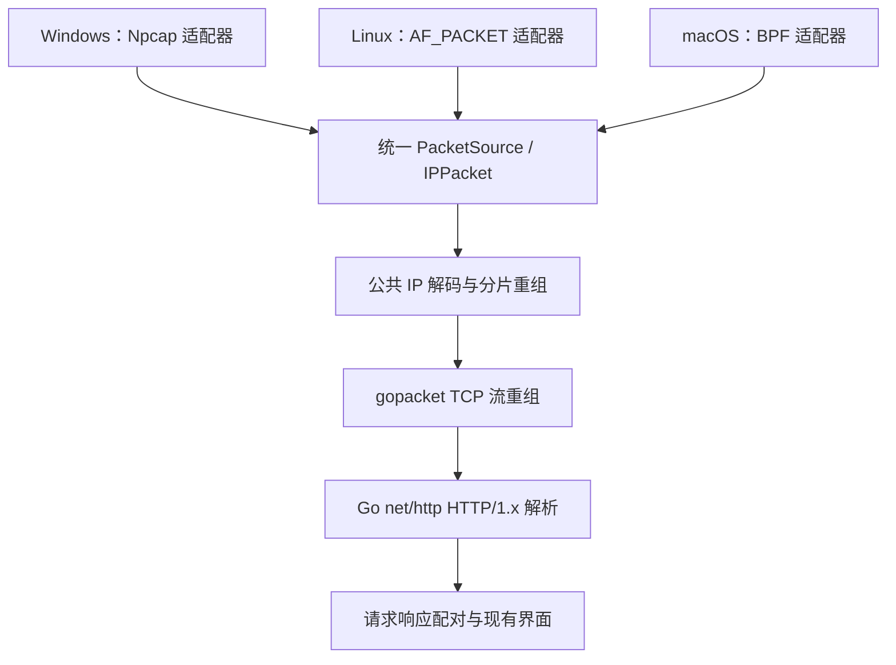

# 开发计划

本页只记录已经讨论的方向，不承诺完成时间，也不把验证工具等同于正式功能。

## 已完成

- 桌面 HTTP/1.x 抓包、服务扫描、请求重发和正文查看。
- 本机 JVM / Arthas 诊断、路由、调用记录、源码与内存查看。
- Go 源码按功能拆包，桌面入口与业务包分离。
- Windows Npcap 命令行工具直接枚举设备并捕获本机 HTTP 请求和响应，不依赖 TShark。

## 待实现：新增功能计划

以下按提出顺序记录，优先级与具体实现范围尚未确定。

| 功能 | 当前状态 | 待明确范围 |
| --- | --- | --- |
| MCP 支持 | 待实现 | 对外提供的能力、连接方式与权限边界 |
| CLI 支持 | 待实现 | 命令覆盖范围、参数与输出格式 |
| SSH 登录 | 待实现 | 登录认证方式与登录后的操作范围 |
| MySQL 监控支持 | 待实现 | 连接方式、监控指标与采集方式 |

现有桌面启动参数和独立 Npcap 命令行验证工具不代表上述 CLI 支持已经完成。

## 后续方向：统一跨平台抓包入口

目标是在 Windows、Linux、macOS 上保留相同的 IP/TCP/HTTP 处理层，仅由平台适配器转换捕获格式。

| 工作 | 当前状态 |
| --- | --- |
| Windows Npcap 设备枚举、链路头转换、单包采集 | 独立工具已验证 |
| 生产用通用接口、并发关闭、诊断和缓存边界 | 待实现与验证 |
| TCP 重组、完整 HTTP 消息解析与请求响应配对 | 待接入并验证 |
| Linux AF_PACKET、macOS BPF 适配器 | 待实现与实机验证 |
| 桌面应用切换到上述链路，去掉 TShark 依赖 | 尚未实施 |

验证需覆盖 loopback、物理网卡、IPv4/IPv6、分片、乱序、重传、缺包、长连接、正文截断及空闲取消。当前讨论范围是明文 HTTP/1.x，不包含新增 HTTPS 解密、HTTP/2 或 HTTP/3 支持。

详细探索草案仍保留在本地 `drafts/`，按项目规则不提交 Git；本页用于记录可公开跟踪的方向和实际状态。
