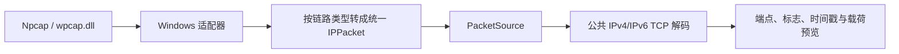

# Npcap 命令行验证工具

独立 Go 模块，验证 Windows amd64 下的抓包设备枚举与明文 HTTP 数据包捕获。已从 WinDivert 切换为 Npcap，源码目录与产物名称相应改为 npcap-probe。现有应用界面未改动。

## 依赖与构建

- 运行需要已安装的 Npcap DLL 和驱动；本机已安装，无需复制 DLL 到 EXE 目录。
- 默认通过系统目录定位 Npcap/wpcap.dll，安全加载该目录及 System32 中的依赖。
- Go 侧只依赖标准库，动态调用 Npcap C ABI，无需 TShark、Wireshark 程序、CGo、Npcap SDK 或 C 编译器。
- 抓包权限取决于 Npcap 安装设置；限制为管理员使用的安装需要管理员权限。

在本目录构建：

```powershell
go build -o ../../native/build/npcap-probe/npcap-probe.exe .
```

## 使用

进入 `native/build/npcap-probe` 后运行：

```powershell
# 直接调用 Npcap 枚举可捕获设备，不是 Go 系统接口列表。
.\npcap-probe.exe -list

# 随机空闲端口启动临时本机服务，捕获并校验 GET 请求和 HTTP 200 响应正文。
.\npcap-probe.exe -self-test

# 抓取已有本机服务的流量，不占用该服务端口。
.\npcap-probe.exe -loopback -port 8080 -duration 30s

# 指定 -list 输出中的原始设备 ID；不要填系统网卡索引。
.\npcap-probe.exe -device '\Device\NPF_{实际设备GUID}' -port 8080 -duration 30s

# 在 N 个匹配的 TCP 包后停止；没有流量仍会在 duration 后退出。
.\npcap-probe.exe -loopback -port 8080 -count 20
```

可用 `-dll` 指定已安装 Npcap 的 wpcap.dll 绝对路径。不自动安装或替换驱动，不设置系统代理，不启动外部抓包工具。

## 抽象与输出



- capture_windows.go：DLL 加载、设备枚举、打开与过滤、包读取、时间戳转换、资源释放。
- adapter_link.go：适配器内部辅助工具，去掉 Ethernet、VLAN、Loopback 等头。
- packet.go：统一 IPPacket / PacketSource 和平台无关 TCP 摘要解码，不依赖 Npcap API 或链路头。
- 输出设备 ID、链路类型、时间戳、IP/端口、TCP 序号、标志和最多 180 字节载荷预览。
- 汇总包含已处理包数、TCP 载荷字节、pcap_received/drop 等底层统计。底层统计口径不同于应用处理包数；未提供统计时显示未知。

## 限制

- 只验证采集与单包解码，未接入 gopacket TCP 重组及完整 net/http 解析配对；自检使用 Go HTTP 服务与客户端生成并校验流量。
- 不解密 HTTPS，不保证单包预览能显示完整 HTTP 头或正文。
- 自检检查小型本机消息的请求及响应正文标记，不代表复杂 TCP 分段、重传、分片和持续高负载可靠性已验证。
- 无 IP 分片重组；遇到分片、截断、未知链路类型或不支持的数据格式明确报错。生产版需要调整过滤以保留重组必要分片。
- 未映射设备到系统网卡索引，不提供 WinDivert 时代的 -ifidx 参数。
- 读取采用非阻塞轮询，可在无流量时响应超时或 Ctrl+C；退出读取后关闭句柄。不支持其他线程直接并发 Close。

## 验证结果（2026-11-21）

- Npcap 实机枚举 10 个设备，包括 WLAN 与 NPF_Loopback。
- 本机 HTTP 自检通过，捕获 GET /npcap-probe、HTTP/1.1 200 OK 和 npcap-probe-ok 正文，客户端往返校验成功。
- 实测自检的 Npcap 丢包计数为 0；不是持续负载无丢包保证。
- 单元测试覆盖 C ABI 布局、链路头转换、IPv4/IPv6 TCP 解码与错误输入。
- 通过设置 NPCAP_PROBE_INTEGRATION=1 运行真实抓包测试，覆盖本机 HTTP 和空闲超时、重复关闭。

```powershell
$env:NPCAP_PROBE_INTEGRATION='1'
go test -v ./...
go vet ./...
```

参考：[Npcap API](https://npcap.com/guide/wpcap/pcap.html)、[设备枚举](https://npcap.com/guide/wpcap/pcap_findalldevs.html)、[读取与内存所有权](https://npcap.com/guide/wpcap/pcap_next_ex.html)。
